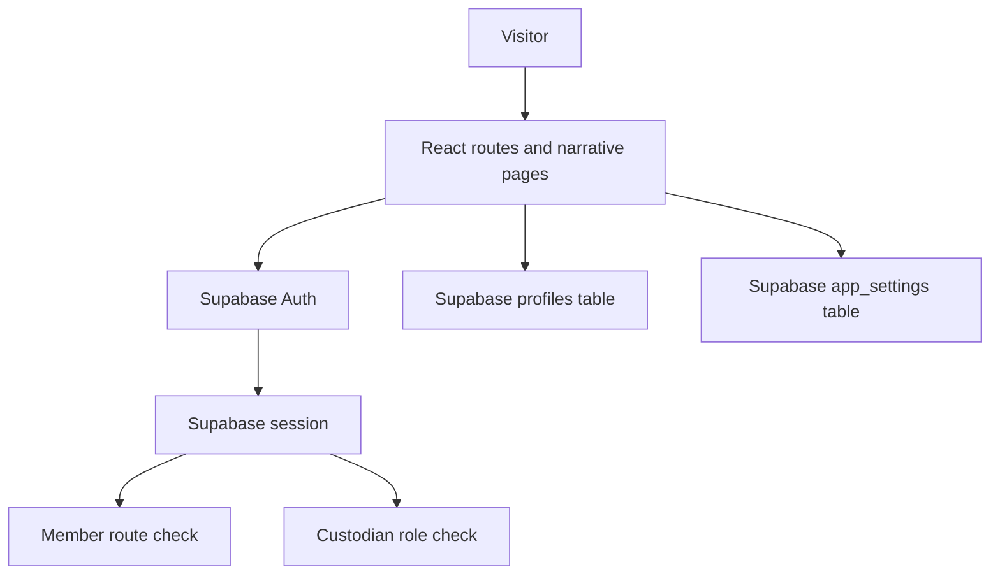

# BlackVault

An interactive, security-themed narrative experience built around a fictional organisation. The frontend combines staged story progression with Supabase authentication and database-backed checks for member and custodian areas.

> **Status:** Frontend project. Supabase authentication and table queries are implemented in the client, but a complete production deployment, database policies, and end-to-end access-control behaviour have not been independently verified.

## Features implemented

- Multi-stage experience: entrance, signup/sign-in, role reveal, briefing, Meridian, and season waitlist
- Email/password signup and sign-in through Supabase Auth
- Google and Discord OAuth initiation
- Email verification / OTP flow
- Member route checks using the current Supabase session
- Custodian route checks against `profiles.is_custodian`
- Member-area maintenance-mode check against `app_settings.maintenance_mode`
- Motion and sound design using Framer Motion, GSAP, and Howler

## Stack

- React, TypeScript, Vite
- React Router
- Supabase JS client
- Tailwind CSS
- Framer Motion, GSAP, Howler
- Vercel Analytics

## Architecture



The route guards improve the client experience, but they are not a substitute for Supabase Row Level Security (RLS) policies. Access-sensitive tables must enforce permissions on the server/database as well.

## Run locally

Requirements: Node.js and npm, plus a Supabase project.

1. Install dependencies:

   ```bash
   npm install
   ```

2. Create a local `.env` file:

   ```dotenv
   VITE_SUPABASE_URL=https://YOUR_PROJECT.supabase.co
   VITE_SUPABASE_ANON_KEY=YOUR_SUPABASE_ANON_KEY
   ```

   These are browser-side Supabase project settings. Never put a Supabase service-role key or other server secret in a `VITE_*` variable.

3. Configure the Supabase Auth providers and redirect URLs for the local origin (normally `http://localhost:5173`) and the deployed origin.

4. Ensure the database has the tables and columns queried by the app, including `profiles.is_custodian` and `app_settings.maintenance_mode`, with appropriate RLS policies.

5. Start the development server:

   ```bash
   npm run dev
   ```

## Available checks

```bash
npm run build
npm run lint
``

There is no test script configured in `package.json` at present. Build and lint results have not been recorded in this README; run both commands against the current checkout before treating them as passing.

## Screenshots

Add screenshots captured from the running application here once the current build has been launched and the key routes have been checked. Do not use the decorative hero asset as a substitute for an application screenshot.

## Important verification still needed

- Confirm OAuth providers and redirect URLs in the Supabase dashboard.
- Verify email OTP behaviour with the project's actual Auth settings.
- Verify RLS policies for `profiles` and `app_settings`; client-side guards alone do not secure data.
- Test member and custodian access with accounts of both roles.
- Check mobile layout, reduced-motion behaviour, and audio handling.

## Repository

[Source code](https://github.com/NemoCode-3011/BlackVault-v1)
